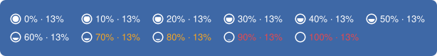

# claude-usage-bar

Shows your Claude plan limits (5-hour session and 7-day weekly) in the macOS menu bar, refreshed every 5 minutes.

```
◒ 23% · 41%          ← menu bar (circle shows what's left of the higher of the two, like a
                        battery: full at 0% used, drains from the top; orange at 70%,
                        red at 90%, ⚠ when stale)
─────────────────
5-hour ████░░░░░░░░░░░░░░░░  23.5%
Resets in 2h 14m (16:30)
7-day  ████████░░░░░░░░░░░░  41.2%
Resets in 3d 4h (Mon 09:00)
```


The icon at 0%, 10%, ... 100% usage, left to right. At real size in the menu bar (5-hour usage · weekly 13%):



Numbers turn orange at 70% and red at 90%; the circle stays white.

## How it works

```
Claude Code ──stdin JSON──▶ bridge/statusline.py ──▶ ~/.cache/claude-usage-bar/usage.json
                               │                                  │
                               └─▶ prints your status line        ▼
                                              SwiftBar runs swiftbar/claude-usage.5m.py every 5 min
```

- Claude Code passes `rate_limits.five_hour` / `seven_day` to its [status line command](https://code.claude.com/docs/en/statusline). This is a documented feature, so there are no credentials, Keychain reads or undocumented endpoints involved.
- The bridge merges each window into the cache with one rule: usage within a window only goes up. A value is accepted only if it's from a newer window (later `resets_at`) or the same window with a higher percentage. Several open sessions can't clobber each other with older data.
- Once a window's reset time passes, the menu bar shows `0%↺` instead of the old number.

### Auto-check (desktop app and editor panels)

Only terminal sessions run the status line, so `bridge/probe.py` fills the gap. On every refresh the plugin starts `probe.py --auto` in the background. A check runs when auto-check isn't paused (menu: **Pause / Resume auto-check**), the last reading is at least 5 minutes old, and either:

- your 5-hour window is still open, which also catches usage from claude.ai and other devices, or
- a Claude Code transcript under `~/.claude/projects` changed since the last reading (some session, in any app, was active).

When you're idle and the 5-hour window has closed, checks stop: any request would itself open a new 5-hour window and shift your reset times. The menu then shows "idle, waiting for activity", and checks resume as soon as you use Claude Code again.

A check runs `claude -p --model haiku` with no tools, no MCP servers, no user settings or hooks, a one-line system prompt, and `--no-session-persistence`, then reads the `rate_limit_event` from its stream-json output. Measured cost: about 900 tokens per check, at most 12 an hour. **Check now** runs one immediately, even while paused.

### Limits of this approach

- Only the **terminal CLI** runs the status line. Tested 2026-10-30: the Claude desktop app's Code tab and the VS Code/Cursor extension's graphical panel never call it. Auto-check covers those, with up to 5 minutes' delay.
- With auto-check paused, numbers update only when a terminal session gets a reply. Usage from claude.ai or the desktop app shares the same limits but shows up only after your next Claude Code reply.
- `rate_limits` is present only on Pro/Max plans (or a gateway with a spend limit).
- Using your own OAuth login against the usage endpoint was ruled out: Anthropic's [legal and compliance page](https://code.claude.com/docs/en/legal-and-compliance) restricts subscription OAuth to Anthropic's own apps.

## Install

Needs macOS, a Claude Pro or Max plan, Claude Code, and Apple's Command Line Tools (`xcode-select --install`; you have them if `git` works).

```bash
git clone <this repo> ~/claude-usage-bar
~/claude-usage-bar/install.sh
```

`install.sh`:

1. Checks the requirements above.
2. Installs [SwiftBar](https://swiftbar.app) with Homebrew if it's missing (it asks first), and sets its plugin folder so it doesn't ask on first launch.
3. Points Claude Code's `statusLine` at the bridge. If you already have a status line, it's kept: it's saved in `~/.config/claude-usage-bar/config.json`, the bridge runs it with the same input, and your terminal shows its output as before. `~/.claude/settings.json` is backed up first.
4. Links the plugin into SwiftBar and starts it.

Before installing, know that auto-check uses your account: while your 5-hour window is open or you're using Claude Code, it sends a tiny Haiku request (about 900 tokens) at most every 5 minutes. **Pause auto-check** in the menu turns it off.

`./uninstall.sh` puts your original status line back (or removes ours) and removes the plugin link. It leaves SwiftBar installed.

The plugin is a symlink into this folder, so keep the folder where it is; `git pull` updates take effect on the next refresh. If you move it, run `install.sh` again.

## Settings (environment variables)

| Variable | Default | Used by |
|---|---|---|
| `CLAUDE_USAGE_BAR_CACHE` | `~/.cache/claude-usage-bar/usage.json` | both |
| `CLAUDE_USAGE_BAR_CONFIG` | `~/.config/claude-usage-bar/config.json` | bridge: your original status line, saved by `install.sh` |
| `CLAUDE_USAGE_BAR_STALE_MIN` | `60` | plugin: minutes without a reading before ⚠ |
| `CLAUDE_USAGE_BAR_PROBE_MIN` | `5` | probe: minimum minutes between readings |
| `CLAUDE_USAGE_BAR_CLAUDE` | found automatically | probe: path to the `claude` binary |
| `CLAUDE_USAGE_BAR_PROJECTS` | `~/.claude/projects` | probe: where to look for session activity |
| `CLAUDE_USAGE_BAR_REFRESH_URL` | `swiftbar://refreshplugin?name=claude-usage` | probe: asks SwiftBar to redraw after a check (`""` disables) |

To refresh more or less often, rename the plugin link (e.g. `claude-usage.1m.py`).

The circle icon is drawn as a PNG by the plugin itself (no image files). Its size, outline width and the gap before the fill are `ICON_PT`, `RING_PT` and `GAP_PT` at the top of `swiftbar/claude-usage.5m.py`. After changing them, run `python3 scripts/render_icon_preview.py` to redraw the preview images above.

## When it breaks

All field parsing lives in `parse_window()` in `bridge/statusline.py`. If Claude Code renames a field, fix it there. To see what Claude Code is sending, temporarily change your `statusLine` command to `tee /tmp/statusline-input.json | <path to bridge>`.

## Tests

```bash
python3 -m unittest discover -s tests -v
```
