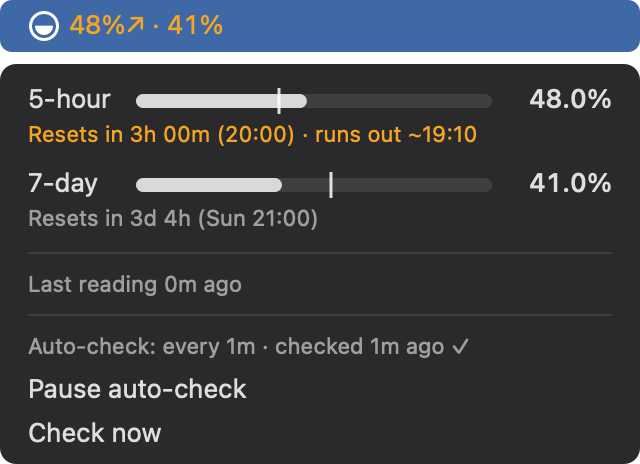
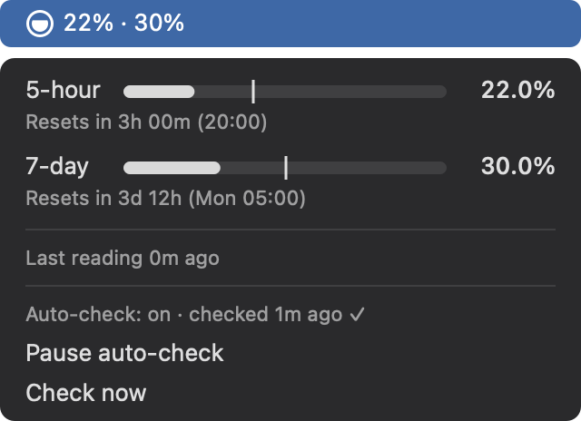

# claude-usage-bar

A small macOS menu bar app that shows your Claude plan limits (5-hour session and 7-day weekly), and when you'll run out at your current pace.


The circle works like a battery: full when you've used nothing, draining from the top as you use more. It follows the higher of your two limits. Numbers turn orange at 70% and red at 90%; the circle stays white. At real size (5-hour usage · weekly 13%):


## Install

Needs macOS 13 or newer, a Claude Pro or Max plan, and [Claude Code](https://code.claude.com).

```bash
curl -fsSL https://raw.githubusercontent.com/kemasaqar/claude-usage-bar/main/install.sh | bash
```

That:

1. Downloads the latest release and puts `ClaudeUsageBar.app` in `/Applications` (or `~/Applications` if you can't write there).
2. Points Claude Code's `statusLine` at the app. If you already have a status line, it's kept: it's saved in `~/.config/claude-usage-bar/config.json`, the app runs it with the same input, and your terminal shows its output as before. `~/.claude/settings.json` is backed up first.
3. Starts the app now and at every login.
4. If you used the older SwiftBar version, removes its plugin so you don't get two items. SwiftBar itself stays installed.

**To update,** run the same command again.

**No security warning:** the app isn't notarized (that needs a paid Apple Developer account), but files downloaded with `curl` aren't marked as coming from the internet, so macOS opens it without asking. If you download `ClaudeUsageBar.zip` from the [Releases page](https://github.com/kemasaqar/claude-usage-bar/releases) in a browser instead, macOS will block it the first time: go to **System Settings → Privacy & Security** and click **Open Anyway**.

**Before installing,** know that auto-check uses your account: while your 5-hour window is open or you're using Claude Code, it sends a tiny Haiku request (about 900 tokens) at most every 5 minutes. **Pause auto-check** in the menu turns it off.

**Menu text too small** (say, on a wide monitor)? Open the menu and pick **Text size**: 80% to 150% in 5% steps. It scales everything in the open menu; the item in the menu bar keeps its normal size. The setting is remembered.

**Don't see it in the menu bar?** Menu bar managers hide new items. Bartender puts them in **Always Hidden**, and Ice in its hidden section: move it to Shown in their settings. On a MacBook with a notch, the item can also end up behind the notch.

### Uninstall

```bash
curl -fsSL https://raw.githubusercontent.com/kemasaqar/claude-usage-bar/main/uninstall.sh | bash
```

It puts your original status line back (or removes ours), removes the login item and deletes the app. Your readings stay in `~/.cache/claude-usage-bar`.

## When will I run out?

- The `│` on each bar shows how much time has passed. If the bar fills past it, you're using your limit faster than time is passing.
- If you'll hit 100% before the reset at your current pace, the reset line says when, for example `runs out ~15:40` in orange, and the number in the menu bar gets a `↗`.
- No warning appears in the first 30 minutes of the 5-hour window or the first 12 hours of the week. That's too early to guess.

| Heading over: 48% used 2 hours into the 5-hour window | On track: 22% used 2 hours in |
|---|---|
|  |  |

These are drawn by the app itself for those numbers, in dark mode (`ClaudeUsageBar render-preview`).

## How it works

```
Claude Code ──stdin JSON──▶ ClaudeUsageBar statusline ──▶ ~/.cache/claude-usage-bar/usage.json
                               │                                       │
                               └─▶ prints your status line             ▼
                                                    ClaudeUsageBar (menu bar) reads it every 15s
```

- Claude Code passes `rate_limits.five_hour` / `seven_day` to its [status line command](https://code.claude.com/docs/en/statusline). This is a documented feature, so there are no credentials, Keychain reads or undocumented endpoints involved.
- One binary does both jobs: run with `statusline`, it's Claude Code's status line command; run normally, it's the menu bar app.
- Each reading is merged into the cache with one rule: usage within a window only goes up. A value is accepted only if it's from a newer window (later `resets_at`) or the same window with a higher percentage. Several open sessions can't clobber each other with older data.
- Once a window's reset time passes, the menu bar shows `0%↺` instead of the old number.

### Auto-check (desktop app and editor panels)

Only terminal sessions run the status line, so the app fills the gap. Every minute it decides whether to check. A check runs when auto-check isn't paused (menu: **Pause / Resume auto-check**), the last reading is at least 5 minutes old, and either:

- your 5-hour window is still open, which also catches usage from claude.ai and other devices, or
- a Claude Code transcript under `~/.claude/projects` changed since the last reading (some session, in any app, was active).

When you're idle and the 5-hour window has closed, checks stop: any request would itself open a new 5-hour window and shift your reset times. The menu then shows "idle, waiting for activity", and checks resume as soon as you use Claude Code again.

A check runs `claude -p --model haiku` with no tools, no MCP servers, no user settings or hooks, a one-line system prompt, and `--no-session-persistence`, then reads the `rate_limit_event` from its stream-json output. Measured cost: about 900 tokens per check, at most 12 an hour. **Check now** runs one immediately, even while paused.

### Limits of this approach

- Only the **terminal CLI** runs the status line. Tested 2026-10-30: the Claude desktop app's Code tab and the VS Code/Cursor extension's graphical panel never call it. Auto-check covers those, with up to 5 minutes' delay.
- With auto-check paused, numbers update only when a terminal session gets a reply. Usage from claude.ai or the desktop app shares the same limits but shows up only after your next Claude Code reply.
- `rate_limits` is present only on Pro/Max plans (or a gateway with a spend limit).
- Using your own OAuth login against the usage endpoint was ruled out: Anthropic's [legal and compliance page](https://code.claude.com/docs/en/legal-and-compliance) restricts subscription OAuth to Anthropic's own apps.

## Settings (environment variables)

These apply to the status line and to `ClaudeUsageBar` run from a terminal. The menu bar app started at login doesn't see your shell's variables.

| Variable | Default | Meaning |
|---|---|---|
| `CLAUDE_USAGE_BAR_CACHE` | `~/.cache/claude-usage-bar/usage.json` | the readings |
| `CLAUDE_USAGE_BAR_CONFIG` | `~/.config/claude-usage-bar/config.json` | your original status line, saved at install |
| `CLAUDE_USAGE_BAR_STALE_MIN` | `60` | minutes without a reading before ⚠ |
| `CLAUDE_USAGE_BAR_PROBE_MIN` | `5` | minimum minutes between auto-checks |
| `CLAUDE_USAGE_BAR_CLAUDE` | found automatically | path to the `claude` binary (when set, only this one is tried) |
| `CLAUDE_USAGE_BAR_PROBE_TIMEOUT_S` | `90` | seconds before a check gives up |
| `CLAUDE_USAGE_BAR_CHAIN_TIMEOUT_S` | `5` | seconds to wait for your original status line before showing ours |
| `CLAUDE_USAGE_BAR_PROJECTS` | `~/.claude/projects` | where to look for session activity |

Command-line modes: `ClaudeUsageBar statusline`, `probe --auto|--now|--pause|--resume`, `setup`, `uninstall`, `render-preview OUT.png [heading-over|on-track|now]`. The binary is at `/Applications/ClaudeUsageBar.app/Contents/MacOS/ClaudeUsageBar`.

## When it breaks

All field parsing lives in `Window.init(json:)` in `Sources/UsageCore/Usage.swift`. If Claude Code renames a field, fix it there. To see what Claude Code is sending, temporarily change your `statusLine` command to `tee /tmp/statusline-input.json | <the current command>`.

## Development

Needs Xcode (for a universal build) or the Command Line Tools.

```bash
swift test                       # all tests
swift build && .build/debug/ClaudeUsageBar   # run the app from source
scripts/build-app.sh 2.0.0       # dist/ClaudeUsageBar.app + .zip, universal, ad-hoc signed
```

Nothing in the tests touches your real setup. They use temporary cache, config and settings files and a fake `claude`. `Tests/ScriptTests` runs the real `install.sh` and `uninstall.sh` with a temporary `HOME`, a fake app, and fake `curl`, `open`, `defaults` and other system commands first on `PATH`.

**Releases:** pushing a tag like `v2.0.0` makes GitHub Actions test, build and publish `ClaudeUsageBar.zip` to a GitHub Release, which is what `install.sh` downloads. Every push also builds the zip as a workflow artifact.

To redraw the menu pictures above: `.build/debug/ClaudeUsageBar render-preview docs/menu-heading-over.png heading-over` (and `on-track`).

## License

MIT. See [LICENSE](LICENSE).
